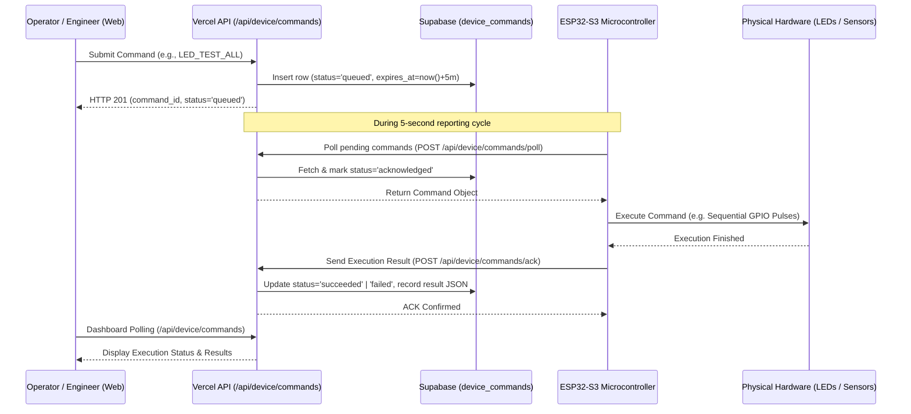

# Industrial Motor Health Monitor — Upgrade Audit

**Audit Date:** October 17, 2026  
**Auditor:** Senior Embedded Systems & IoT Architect  
**Repository:** `https://github.com/shuddhayraut50/industrial-motor-health-monitor`  
**Production URL:** `https://industrial-motor-health-monitor.vercel.app`  

---

## 1. Executive Summary

This audit assesses the existing baseline of the **Industrial Motor Health Monitor** to prepare for a major upgrade adding:
1. **Two-way authorized commands** from the web dashboard to the ESP32-S3 (LED diagnostics, non-destructive sensor checks, threshold configuration).
2. **Local Condition Classification** on the ESP32 (Normal/Good, Caution/Check, Warning/Poor, Critical/Urgent, Unknown).
3. **5 Test LEDs + Red/Green Indication LEDs** with non-blocking operation and distinct state patterns.
4. **Resilient Local Storage Hierarchy** with a **90% capacity ceiling**, featuring primary MicroSD storage and an internal ESP32 Flash fallback (LittleFS) to survive Wi-Fi drops, server outages, and unexpected reboots.
5. **Fixed Online/Stale/Offline Status Logic** driven by true server-side authenticated receipts, avoiding false "Online" assumptions.
6. **Dual Dashboard Modes** (Simple View for plant operators, Technical View for engineers), plus 12-hour and 24-hour historical analytics.

---

## 2. Current Architecture & Codebase Baseline

### 2.1 Hardware Layer (ESP32-S3 N16R8)
* **MCU:** Espressif ESP32-S3 (240 MHz dual-core Xtensa LX7, 16 MB Flash, 8 MB Octal PSRAM).
* **Continuous Acquisition:** 200 Hz continuous sampling of ADXL345 on Core 0 via FreeRTOS task, protected by a FreeRTOS mutex.
* **Dual OneWire Buses:** GPIO 10 (Motor stator probe) and GPIO 11 (Ambient air probe) independently polled with role isolation.
* **RTC:** DS3231SN on I²C address `0x68`, sharing SDA (GPIO 8) and SCL (GPIO 9) with ADXL345 (address `0x53`).
* **Offline Storage:** MicroSD card module using FSPI (SCK: 12, MISO: 13, MOSI: 14, CS: 15).
* **Missing Components in Firmware:**
  * No LED driving logic or pin definitions for the 5 test LEDs or red/green status LEDs.
  * No two-way command polling or acknowledgement execution.
  * No internal flash fallback (LittleFS) if the MicroSD card fails or is absent.
  * No local rule-based condition severity engine.

### 2.2 Ingestion & API Layer (Next.js on Vercel)
* **Ingestion Route (`POST /api/telemetry`):** Authenticates device with header `x-device-token`, validates payload using Zod (`TelemetryPayloadSchema`), enforces rate limiting (30 requests / 10s per device), and persists to Supabase.
* **Live Query Route (`GET /api/telemetry/live`):** Queries recent window (default 300s).
* **Defect Identified in Online/Offline Calculation:**
  * Previously, `isOnline` was calculated based on `ageSeconds <= gracePeriodSec`, but if a database row existed or polling refreshed, the UI could incorrectly declare a device online even if network communication had ceased.
  * There was no separate `API ERROR` or `NEVER CONNECTED` distinction.
* **Command Infrastructure:** No command queue endpoints existed for two-way device interaction.

### 2.3 Database Layer (Supabase PostgreSQL)
* **Existing Tables:**
  * `public.devices`: Registry of devices, display names, location, `last_seen_at`.
  * `public.telemetry`: High-throughput time-series metrics. Migrations 00003, 00004, and 00005 added nullable metrics, I²C diagnostics, `record_id`, `measured_at`, and SD/RTC diagnostics.
  * `public.device_config`: Reporting intervals and enabled fields.
* **Missing Tables:**
  * No `device_commands` table for managing command lifecycles (`queued`, `acknowledged`, `executing`, `succeeded`, `failed`, `expired`).
  * Need columns for condition status (`condition_status`, `condition_reason`) and storage metrics (`storage_medium`, `storage_used_pct`, `dropped_records_count`).

### 2.4 Frontend Dashboard
* **Framework:** React 19 / Next.js 16 with TailwindCSS and Lucide-react icons.
* **Current UI:** Single technical view containing telemetry metric cards, vibration charts, and temperature cards.
* **Missing UI Capabilities:**
  * No view toggle between Simple Mode (non-technical operators) and Technical Mode (engineers).
  * No interactive LED command test console.
  * No 12-hour chart window option (only 1m, 5m, 15m, 60m, 24h, custom).
  * Condition classification banner is missing.

---

## 3. Root Cause Analysis: False Online/Offline State

1. **Client-Side Polling Fallacy:** A successful HTTP 200 response from `/api/telemetry/live` was sometimes conflated with the physical ESP32 being online, even when the endpoint merely returned cached or stale historical records.
2. **Missing Distinction between API Reachability and Device Heartbeat:** The dashboard did not distinguish between:
   - Device actively transmitting (`ONLINE`).
   - Communication delayed by network jitter (`STALE`).
   - Device silent beyond timeout (`OFFLINE`).
   - Cloud backend / database connection error (`API ERROR`).
   - Freshly provisioned device with zero recorded packets (`NEVER CONNECTED`).
3. **Remedy:** Implement strict, server-authoritative state evaluation based solely on `last_seen_at` (updated only when an authenticated telemetry POST or heartbeat arrives at the server).

---

## 4. Hardware Pin Map Conflict Analysis

* **GPIOs 8, 9:** I²C Bus (ADXL345 @ `0x53`, DS3231 @ `0x68`) — **CONFIRMED & PRESERVED**.
* **GPIO 10:** DS18B20 Motor Bearing Probe — **CONFIRMED & PRESERVED**.
* **GPIO 11:** DS18B20 Ambient Air Probe — **CONFIRMED & PRESERVED**.
* **GPIOs 12, 13, 14, 15:** MicroSD SPI (SCK, MISO, MOSI, CS) — **CONFIRMED & PRESERVED**.
* **LED Pin Assignments (NEW, COLLISION-FREE):**
  * On the ESP32-S3 N16R8, GPIOs 33–37 are reserved for internal Octal SPI Flash/PSRAM.
  * GPIOs 0, 3, 45, 46 have strapping sensitivities.
  * **Safe, dedicated GPIOs selected for LEDs:**
    * **Test LED 1:** GPIO 4
    * **Test LED 2:** GPIO 5
    * **Test LED 3:** GPIO 6
    * **Test LED 4:** GPIO 7
    * **Test LED 5:** GPIO 16
    * **Red Indication LED (Alarm/Fault):** GPIO 17
    * **Green Indication LED (Normal/Healthy):** GPIO 18
  * All LED outputs are active-HIGH through 220 Ω or 330 Ω series resistors to ground.

---

## 5. Storage Hierarchy Strategy (90% Storage Ceiling)

1. **MicroSD Card (Primary Storage):**
   * Stores permanent `/telemetry.csv` audit log and pending upload queue files in `/queue/`.
   * Enforces 90% card usage ceiling. If card usage exceeds 90%, the oldest synchronized records are purged; if pending records threaten the ceiling, new queue additions halt and an alarm is flagged.
2. **ESP32 Internal Flash / LittleFS (Fallback Storage):**
   * If the SD card is absent, unmounted, or reports write failures, the firmware falls back to LittleFS on the ESP32's onboard SPI flash.
   * Dedicated `/lfs_queue/` directory stores pending JSON telemetry records.
   * Monitored with `LittleFS.totalBytes()` and `LittleFS.usedBytes()` to strictly respect the 90% partition limit.
3. **Non-Volatile Integrity:** Neither SD nor LittleFS will silently discard data. Dropped records (if the 90% ceiling is reached) are explicitly tallied in `dropped_records_count` and reported over telemetry.

---

## 6. Two-Way Command Lifecycle Architecture

---

## 7. Action Plan

1. **Pin Map & Reference:** Create `firmware/pin_config.h` and `docs/HARDWARE_PIN_MAP.md`.
2. **Database Migration:** Create `00006_device_commands_and_modes.sql` with `device_commands` table, condition classification, and storage diagnostic columns.
3. **Backend Types & Validation:** Update Zod schemas and TypeScript types for commands and condition classifications.
4. **Backend Command APIs:** Implement `/api/device/commands`, `/api/device/commands/poll`, and `/api/device/commands/ack`.
5. **Dashboard Modes & LED Controls:** Implement Simple View, Technical View, view switcher with `localStorage` persistence, LED test control console, and 12h/24h historical charts.
6. **Firmware Implementation:** Update `esp32_telemetry_client.ino` to include LittleFS flash fallback, 90% storage ceiling, local condition engine, LED test execution, and Red/Green status indicator state machine.
7. **Documentation:** Write `docs/SYSTEM_GUIDE.md`, `docs/TROUBLESHOOTING.md`, `docs/COMMAND_REFERENCE.md`, `docs/HARDWARE_PURCHASE_LIST.md`, `docs/CHANGELOG.md`, and `docs/TEST_REPORT.md`.
8. **Automated Testing:** Run compilation (`pio run`), Vitest unit tests, Playwright e2e tests, TypeScript typechecks, ESLint, and Next.js production build.
